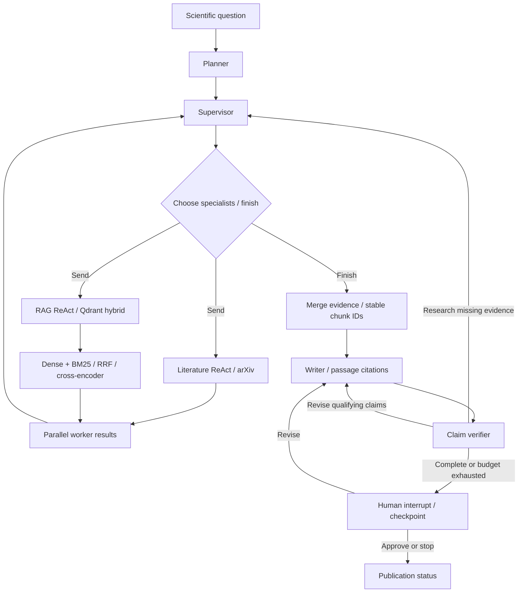

# Multi-Agent Scientific Research Assistant

**LangGraph · Agentic AI · Qdrant Hybrid RAG · Cross-Encoder Reranking · Evidence-Aware Verification · FastAPI**

A portfolio-scale scientific literature research assistant. A LangGraph supervisor delegates focused searches to **parallel ReAct specialists** (arXiv + full-text Qdrant), merges retrieved passages, writes an evidence-linked report, and verifies key claims before pausing for **human review**. Research threads survive CLI process restarts through SQLite checkpoints.

> **Status: portfolio MVP / local demonstration — not a production web service and not an automated scientific peer reviewer.** The final example correctly ended with an unverified report and human-selected `stop`.

## Architecture



## Highlights

- **Parallel orchestration:** supervisor-directed tasks, LangGraph `Send`, state reducers, and separate ReAct tool subgraphs.
- **Full-text scientific RAG:** PDF chunking with page/URL metadata; dense OpenAI embeddings + BM25 sparse search in Qdrant; reciprocal rank fusion and cross-encoder reranking.
- **Evidence tracking:** citation IDs of the form `[E:<chunk_id>]` resolve to retrieved passages. A deterministic validator rejects unknown or malformed citation groups.
- **Claim-level reflection:** extracted scientific assertions are evaluated against *their cited passages*. Failed assertions prompt targeted research or revision. Revision also proposes candidate passages already in the registry; candidates are **not automatically considered supporting evidence**.
- **Human-in-the-loop:** pause, inspect, `approve`, `revise`, or `stop`; unresolved scientific issues remain visible and approval status is explicit.
- **Local app:** CLI and a localhost-only FastAPI interface with checkpointed research threads.

## Quickstart (macOS/Linux)

Requirements: Python 3.12+, [uv](https://docs.astral.sh/uv/), Docker, an OpenAI API key, and access to legally downloadable scientific PDFs.

```bash
cp .env.example .env
# Edit .env: OPENAI_API_KEY=...
uv sync --locked
docker compose up -d
```

If you're using the same machine and persistent Qdrant storage as an earlier version, you can reuse the existing full-text collection. Otherwise place matching PDFs in `papers/` according to `examples/papers_manifest.json` and run:

```bash
uv run python examples/ingest_fulltext.py
```

The included manifest is a **template**, not bundled PDF content. Verify downloaded file names, URLs, titles, and licensing before ingestion. Qdrant must already be running. The first sparse/reranker invocation may download model weights.

**Run the CLI:**

```bash
uv run multi-agent-research start --question "Viscous fingering patterns in immiscible Hele-Shaw flow"
# Copy the thread_id displayed by the CLI
uv run multi-agent-research status YOUR_THREAD_ID
uv run multi-agent-research resume YOUR_THREAD_ID
```

On `resume`, inspect verification issues and choose `stop`, `revise`, or `approve`. Use **fresh thread IDs** after graph changes; older SQLite checkpoint schemas may not be compatible.

**Local API (do not expose publicly):**

```bash
uv run uvicorn research_assistant.api:app --host 127.0.0.1 --port 8000
# Visit http://127.0.0.1:8000/docs
```

## Tests and demo

```bash
uv run pytest -q
```

The previous local release passed **24/24 tests** on the maintainer's Mac. This updated release includes additional evidence-selection tests and requires a **fresh full test run and live E2E validation** before tagging. See [demo instructions](examples/demo/README.md) and the [sanitized sample trace](examples/demo/sample_trace.txt).

In the captured earlier run, the agents completed research, followed a verifier-triggered research loop, revised the report, and checkpointed at human review. **Only 5/10 model-extracted claims were rated supported**; the user chose `stop`, and the terminal status was `stopped_without_approval`. This is deliberate transparency, not a claim that the research was validated.

## Key modules

| Component | Location |
| --- | --- |
| Planner, supervisor, ReAct specialists, `Send` workers | `src/research_assistant/agents/research.py` |
| Graph, checkpointing, CLI, human review | `src/research_assistant/graphs/workflow.py` |
| Hybrid retrieval and cross-encoder reranking | `src/research_assistant/retrieval/` |
| Qdrant tool wrapper | `src/research_assistant/tools/qdrant.py` |
| Citation parsing, evidence registry, claim checking | `src/research_assistant/verification/` |
| Local FastAPI endpoints | `src/research_assistant/api.py` |
| PDF ingestion and evaluation scripts | `examples/`, `evaluation/` |
| Design rationale and limitations | [`docs/TECHNICAL_DESIGN.md`](docs/TECHNICAL_DESIGN.md) |

## Limitations and future work

- Human review and LLM verdicts do **not** guarantee scientific correctness. Claim extraction is capped and may miss important claims. Retrieval quality depends on the indexed corpus.
- Equation and figure extraction may be incomplete. The simple lexical evidence-candidate ranker is a **hinting mechanism**, not an entailment model.
- This API has no authentication, per-user isolation, execution cost limits, or asynchronous durable workers. **Never bind it to a publicly accessible interface.**
- Future work: evaluate on human-labeled claims, expand PDF/table parsing, add explicit evidence-version snapshots, move to PostgreSQL checkpoints and background execution, and implement security and monitoring before public access.

## Reproducibility & data handling

- `.env`, `papers/`, Qdrant storage, checkpoint databases and caches are ignored. The repository includes no API credentials or private PDFs.
- Config template: [`.env.example`](.env.example). Dependency versions: `uv.lock`.
- Run instructions and a sample trace are included, but stochastic LLM responses mean exact outputs will vary.

## License

See [LICENSE](LICENSE) for the source-code license. Third-party models, tools, papers, and dependencies retain their own licenses and usage terms.
